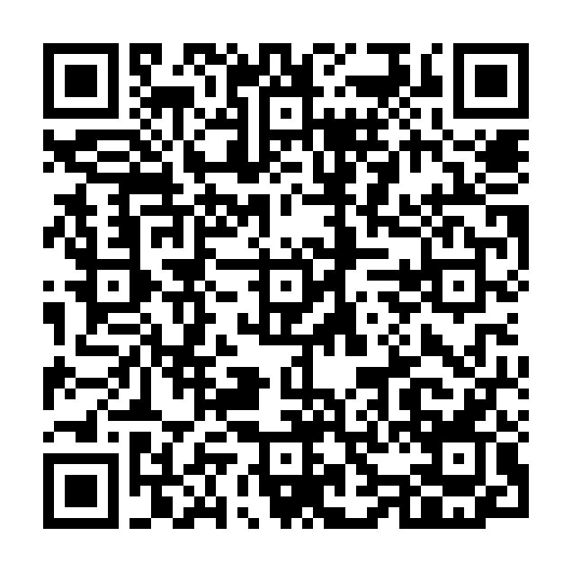
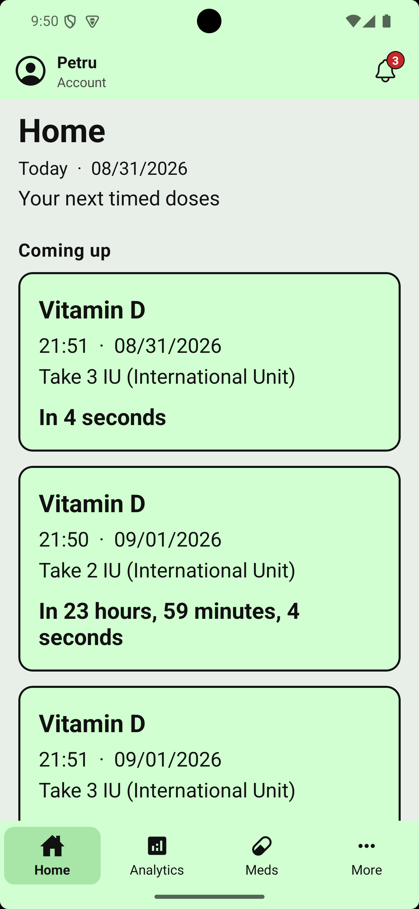
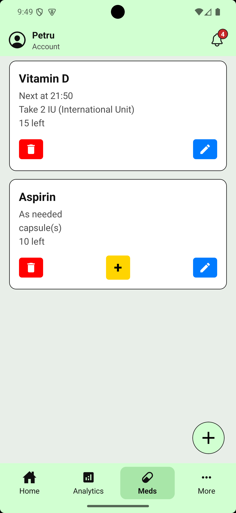
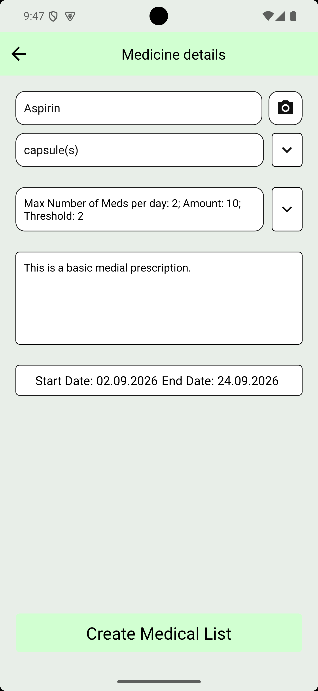
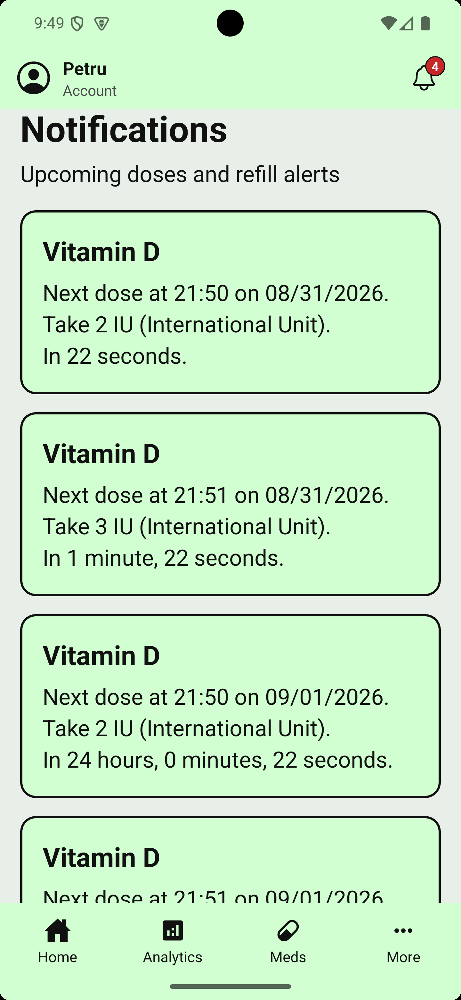
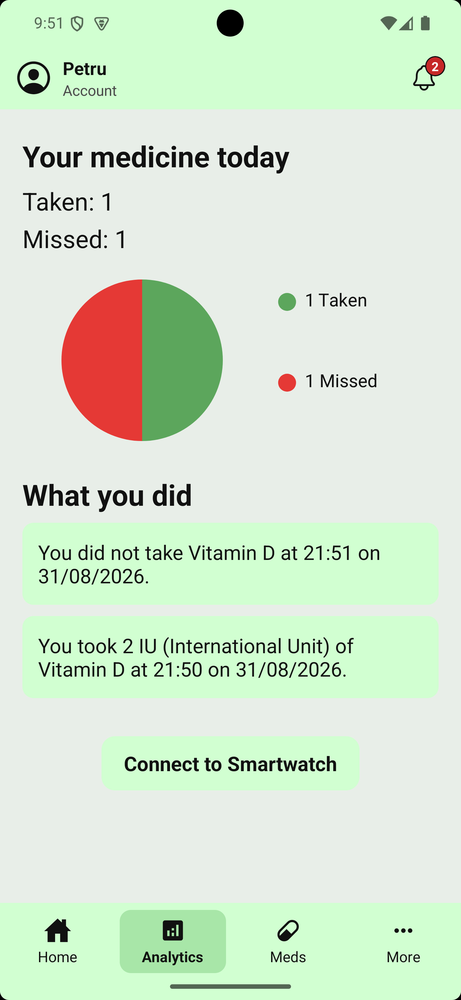
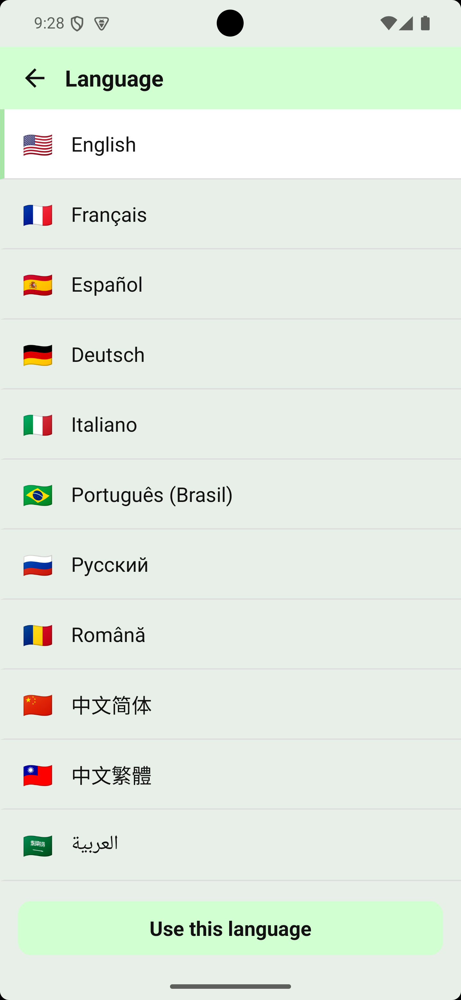
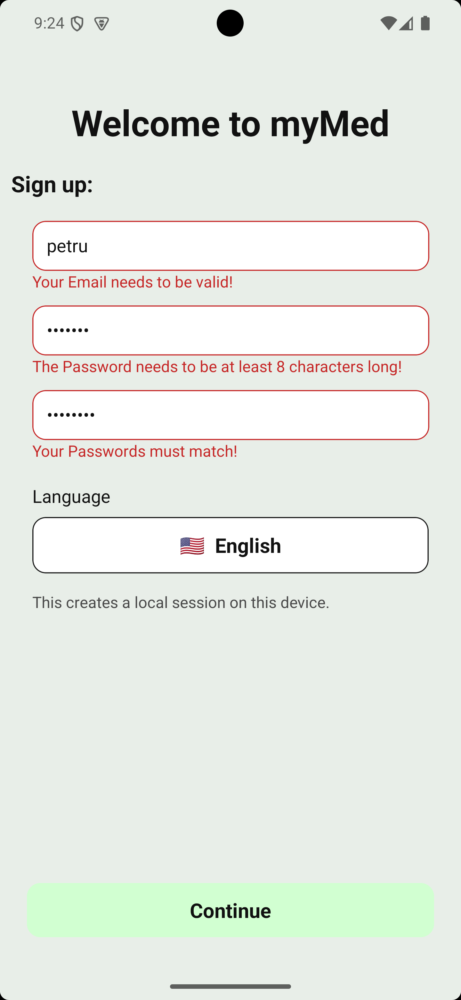
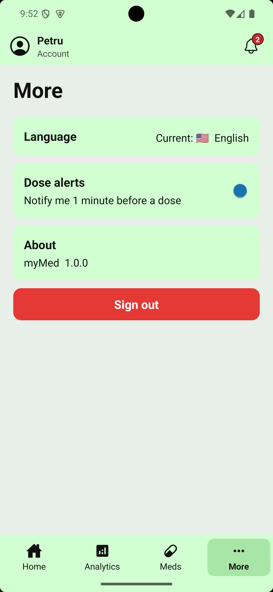
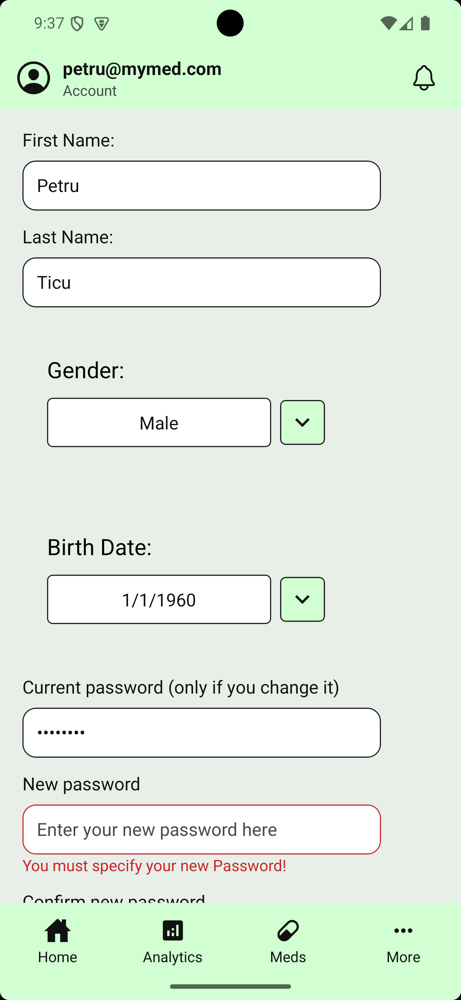

# myMed

An on-device medication reminder client for iOS and Android.

<p align="center">
  
</p>

<p align="center">Scan with <strong>Expo Go</strong> to open myMed. On iPhone, sign in to Expo Go as <strong>petru-ticu</strong> first.</p>

myMed is the scheduling layer of a medicine app: when the next dose is due, whether you took it, how much is left, and what to do when the pack is running out. It runs entirely on the phone. There is no account server and no cloud database in this build. That is a deliberate first slice — the product logic is in the client, not behind a login wall that does not exist yet.

Built with **React Native**, **Expo SDK 58**, and **JavaScript**.

---

## What you can do

- Start a **local session** with email and password rules (length, capital, symbol). This is not an online account.
- Add medicines by typing or by **scanning a barcode / QR code**. A QR that carries name, unit, or notes fills the form. A numeric barcode is stored as the code. There is no drug database behind the camera.
- Set real schedules: as needed, several times a day, every *N* hours, every *N* days, specific weekdays, or an on/off cycle.
- See **due now** and **coming up** on Home, with a countdown. Tap a due dose to mark it taken or skipped.
- Get **in-app** reminders and inventory warnings (approaching the refill point, at the threshold, empty).
- Track taken vs missed for today, plus a recent activity list. Optionally connect a BLE heart-rate device in a **development or production build**.
- Switch the UI among **32 languages**. String catalogs ship in the app. Missing keys fall back to English. The app does not call a translation API at runtime.

---

## Scope of this build

| Included | Not in this build |
| --- | --- |
| Session, meds, doses, inventory, i18n, scan, analytics | Cloud login, password recovery, multi-device sync |
| In-app dose prompts on Expo Go | Data that survives killing the app (nothing is persisted yet) |
| Lock-screen alerts in a native build | Looking up medicines on the internet |
| BLE heart rate when the native module is present | App Store / Play Store listing |

Expo Go on Android does not load `expo-notifications` (removed for push in SDK 53+). myMed skips that module in Expo Go and keeps reminders on screen. A development build is what you use if you want OS notifications and Bluetooth.

This is not medical software. It does not give clinical advice.

---

## Stack

- React Native 0.88, React 19, Expo 58
- React Navigation (stack)
- Offline i18n: English master catalog + JSON locales
- Camera: `expo-camera`
- Charts: `react-native-chart-kit`
- BLE: `react-native-ble-plx` (guarded; unused in Expo Go)

---

## Run

Node **20.19.4** or newer.

```sh
npm install
npx expo start
```

Open it in **Expo Go** (same Wi‑Fi, or a tunnel if you must). For lock-screen notifications or heart rate:

```sh
npx expo start --dev-client
# or
npm run android
npm run ios
```

```sh
npm test
```

Unit tests cover inventory math, scanned-code parsing, and the Expo Go notification guard.

---

## How the client is split

- **Home / Notifications** — upcoming occurrences and due doses, derived from each medicine’s frequency string.
- **My Meds** — create, edit, delete; scan can prefill the typing form.
- **Dose host** — a session-wide layer that queues take/skip prompts and inventory alerts so they are not tied to one screen.
- **Analytics** — today’s taken/missed counts from the in-memory dose log.
- **More** — language, the “one minute before” preference, sign out (clears this session).

Nothing here is a backend. Stores live in memory for the lifetime of the process.

---

## Demo


<p align="center">
  
  
  
</p>
<p align="center">Home · My Meds · Add a medicine</p>

<p align="center">
  
  
  
</p>
<p align="center">Notifications · Analytics · Languages</p>

<p align="center">
  
  
  
</p>
<p align="center">Sign up · More · Account settings</p>

---

## License

[MIT](LICENSE). Use and fork freely.

This is not medical software. Do not present it as a certified health product.
